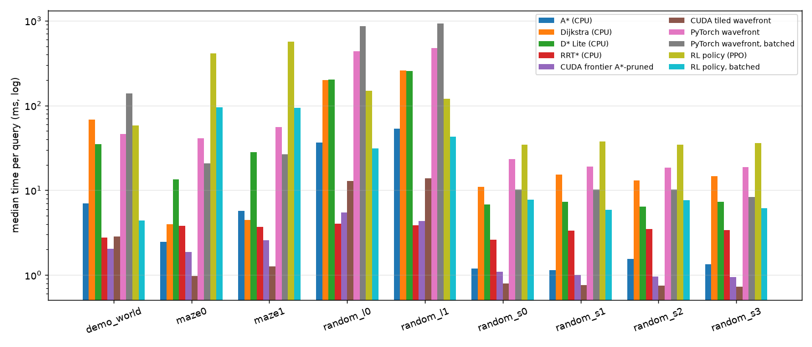
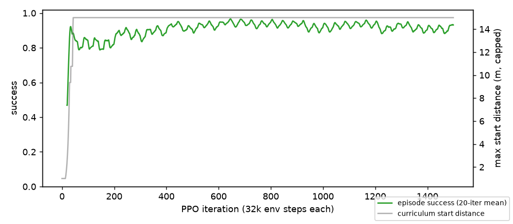

# Planner benchmark

Measured on a Lenovo IdeaPad Pro 5: AMD Ryzen AI 5 340 (CPU planners, single-threaded) and an NVIDIA GeForce RTX 5050 Laptop GPU, 8 GB (CUDA, PyTorch and RL planners), in the project containers. Times are medians of 3 runs per query (RRT*: 1 seeded run) and include result copy-back to the host.

Median wall time per query (ms), success rate, and path cost relative to the optimal 26-connected path (1.000 = optimal). Batched rows report batch time divided by the number of queries.

## Summary (all maps)

| planner | success | speed-up vs A* (geo. mean) | mean cost ratio |
|---|---|---:|---:|
| A* (CPU) | 96/96 | 1.00x | 1.000 |
| Dijkstra (CPU) | 96/96 | 0.19x | 1.000 |
| D* Lite (CPU) | 96/96 | 0.19x | 1.000 |
| RRT* (CPU) | 90/96 | 1.27x | 1.057 |
| CUDA frontier A*-pruned | 96/96 | 2.37x | 1.000 |
| CUDA tiled wavefront | 96/96 | 2.40x | 1.000 |
| PyTorch wavefront | 96/96 | 0.08x | 1.000 |
| PyTorch wavefront, batched | 96/96 | 0.10x | 1.000 |
| RL policy (PPO) | 88/96 | 0.05x | 1.551 |
| RL policy, batched | 88/96 | 0.26x | 1.551 |

## demo_world (763,848 voxels)

| planner | device | success | median ms | p95 ms | cost ratio |
|---|---|---|---:|---:|---:|
| A* (CPU) | cpu | 32/32 | 6.95 | 24.56 | 1.000 |
| Dijkstra (CPU) | cpu | 32/32 | 68.34 | 94.27 | 1.000 |
| D* Lite (CPU) | cpu | 32/32 | 35.24 | 131.39 | 1.000 |
| RRT* (CPU) | cpu | 32/32 | 2.78 | 5.42 | 1.061 |
| CUDA frontier A*-pruned | cuda | 32/32 | 2.05 | 2.58 | 1.000 |
| CUDA tiled wavefront | cuda | 32/32 | 2.83 | 3.34 | 1.000 |
| PyTorch wavefront | cuda | 32/32 | 45.92 | 53.75 | 1.000 |
| PyTorch wavefront, batched | cuda | 32/32 | 138.93 | 138.93 | 1.000 |
| RL policy (PPO) | cuda | 32/32 | 57.87 | 87.25 | 1.008 |
| RL policy, batched | cuda | 32/32 | 4.43 | 4.43 | 1.008 |

## maze0 (186,624 voxels)

| planner | device | success | median ms | p95 ms | cost ratio |
|---|---|---|---:|---:|---:|
| A* (CPU) | cpu | 8/8 | 2.47 | 6.99 | 1.000 |
| Dijkstra (CPU) | cpu | 8/8 | 3.98 | 6.18 | 1.000 |
| D* Lite (CPU) | cpu | 8/8 | 13.45 | 38.89 | 1.000 |
| RRT* (CPU) | cpu | 7/8 | 3.81 | 7.01 | 1.029 |
| CUDA frontier A*-pruned | cuda | 8/8 | 1.87 | 2.93 | 1.000 |
| CUDA tiled wavefront | cuda | 8/8 | 0.97 | 1.10 | 1.000 |
| PyTorch wavefront | cuda | 8/8 | 41.12 | 50.52 | 1.000 |
| PyTorch wavefront, batched | cuda | 8/8 | 20.79 | 20.79 | 1.000 |
| RL policy (PPO) | cuda | 4/8 | 412.05 | 679.40 | 1.764 |
| RL policy, batched | cuda | 4/8 | 95.27 | 95.27 | 1.764 |

## maze1 (186,624 voxels)

| planner | device | success | median ms | p95 ms | cost ratio |
|---|---|---|---:|---:|---:|
| A* (CPU) | cpu | 8/8 | 5.74 | 9.43 | 1.000 |
| Dijkstra (CPU) | cpu | 8/8 | 4.45 | 6.23 | 1.000 |
| D* Lite (CPU) | cpu | 8/8 | 28.15 | 37.48 | 1.000 |
| RRT* (CPU) | cpu | 3/8 | 3.70 | 5.51 | 1.064 |
| CUDA frontier A*-pruned | cuda | 8/8 | 2.58 | 2.90 | 1.000 |
| CUDA tiled wavefront | cuda | 8/8 | 1.27 | 1.49 | 1.000 |
| PyTorch wavefront | cuda | 8/8 | 55.29 | 63.43 | 1.000 |
| PyTorch wavefront, batched | cuda | 8/8 | 26.58 | 26.58 | 1.000 |
| RL policy (PPO) | cuda | 4/8 | 565.41 | 676.35 | 4.822 |
| RL policy, batched | cuda | 4/8 | 93.71 | 93.71 | 4.822 |

## random_l0 (2,400,000 voxels)

| planner | device | success | median ms | p95 ms | cost ratio |
|---|---|---|---:|---:|---:|
| A* (CPU) | cpu | 8/8 | 36.54 | 151.75 | 1.000 |
| Dijkstra (CPU) | cpu | 8/8 | 198.01 | 261.26 | 1.000 |
| D* Lite (CPU) | cpu | 8/8 | 202.39 | 731.52 | 1.000 |
| RRT* (CPU) | cpu | 8/8 | 4.05 | 7.88 | 1.153 |
| CUDA frontier A*-pruned | cuda | 8/8 | 5.49 | 6.74 | 1.000 |
| CUDA tiled wavefront | cuda | 8/8 | 12.80 | 14.40 | 1.000 |
| PyTorch wavefront | cuda | 8/8 | 438.19 | 517.23 | 1.000 |
| PyTorch wavefront, batched | cuda | 8/8 | 864.55 | 864.55 | 1.000 |
| RL policy (PPO) | cuda | 8/8 | 149.89 | 213.14 | 1.195 |
| RL policy, batched | cuda | 8/8 | 31.33 | 31.33 | 1.195 |

## random_l1 (2,400,000 voxels)

| planner | device | success | median ms | p95 ms | cost ratio |
|---|---|---|---:|---:|---:|
| A* (CPU) | cpu | 8/8 | 53.50 | 102.98 | 1.000 |
| Dijkstra (CPU) | cpu | 8/8 | 257.22 | 282.73 | 1.000 |
| D* Lite (CPU) | cpu | 8/8 | 253.55 | 677.54 | 1.000 |
| RRT* (CPU) | cpu | 8/8 | 3.89 | 6.15 | 1.225 |
| CUDA frontier A*-pruned | cuda | 8/8 | 4.31 | 5.37 | 1.000 |
| CUDA tiled wavefront | cuda | 8/8 | 13.93 | 15.88 | 1.000 |
| PyTorch wavefront | cuda | 8/8 | 473.93 | 537.67 | 1.000 |
| PyTorch wavefront, batched | cuda | 8/8 | 925.22 | 925.22 | 1.000 |
| RL policy (PPO) | cuda | 8/8 | 120.67 | 247.82 | 1.117 |
| RL policy, batched | cuda | 8/8 | 42.80 | 42.80 | 1.117 |

## random_s0 (196,608 voxels)

| planner | device | success | median ms | p95 ms | cost ratio |
|---|---|---|---:|---:|---:|
| A* (CPU) | cpu | 8/8 | 1.19 | 3.19 | 1.000 |
| Dijkstra (CPU) | cpu | 8/8 | 10.96 | 16.31 | 1.000 |
| D* Lite (CPU) | cpu | 8/8 | 6.78 | 18.28 | 1.000 |
| RRT* (CPU) | cpu | 8/8 | 2.60 | 4.53 | 0.999 |
| CUDA frontier A*-pruned | cuda | 8/8 | 1.10 | 1.57 | 1.000 |
| CUDA tiled wavefront | cuda | 8/8 | 0.80 | 0.84 | 1.000 |
| PyTorch wavefront | cuda | 8/8 | 23.17 | 23.53 | 1.000 |
| PyTorch wavefront, batched | cuda | 8/8 | 10.22 | 10.22 | 1.000 |
| RL policy (PPO) | cuda | 8/8 | 34.36 | 52.90 | 1.023 |
| RL policy, batched | cuda | 8/8 | 7.78 | 7.78 | 1.023 |

## random_s1 (196,608 voxels)

| planner | device | success | median ms | p95 ms | cost ratio |
|---|---|---|---:|---:|---:|
| A* (CPU) | cpu | 8/8 | 1.15 | 3.85 | 1.000 |
| Dijkstra (CPU) | cpu | 8/8 | 15.39 | 18.84 | 1.000 |
| D* Lite (CPU) | cpu | 8/8 | 7.31 | 18.79 | 1.000 |
| RRT* (CPU) | cpu | 8/8 | 3.35 | 3.51 | 0.982 |
| CUDA frontier A*-pruned | cuda | 8/8 | 1.00 | 1.13 | 1.000 |
| CUDA tiled wavefront | cuda | 8/8 | 0.76 | 0.85 | 1.000 |
| PyTorch wavefront | cuda | 8/8 | 18.91 | 21.80 | 1.000 |
| PyTorch wavefront, batched | cuda | 8/8 | 10.20 | 10.20 | 1.000 |
| RL policy (PPO) | cuda | 8/8 | 37.89 | 42.41 | 1.001 |
| RL policy, batched | cuda | 8/8 | 5.88 | 5.88 | 1.001 |

## random_s2 (196,608 voxels)

| planner | device | success | median ms | p95 ms | cost ratio |
|---|---|---|---:|---:|---:|
| A* (CPU) | cpu | 8/8 | 1.54 | 3.65 | 1.000 |
| Dijkstra (CPU) | cpu | 8/8 | 13.12 | 20.37 | 1.000 |
| D* Lite (CPU) | cpu | 8/8 | 6.39 | 11.34 | 1.000 |
| RRT* (CPU) | cpu | 8/8 | 3.47 | 5.00 | 1.003 |
| CUDA frontier A*-pruned | cuda | 8/8 | 0.96 | 1.13 | 1.000 |
| CUDA tiled wavefront | cuda | 8/8 | 0.75 | 0.85 | 1.000 |
| PyTorch wavefront | cuda | 8/8 | 18.52 | 23.24 | 1.000 |
| PyTorch wavefront, batched | cuda | 8/8 | 10.17 | 10.17 | 1.000 |
| RL policy (PPO) | cuda | 8/8 | 34.35 | 52.80 | 1.022 |
| RL policy, batched | cuda | 8/8 | 7.62 | 7.62 | 1.022 |

## random_s3 (196,608 voxels)

| planner | device | success | median ms | p95 ms | cost ratio |
|---|---|---|---:|---:|---:|
| A* (CPU) | cpu | 8/8 | 1.34 | 3.53 | 1.000 |
| Dijkstra (CPU) | cpu | 8/8 | 14.58 | 17.38 | 1.000 |
| D* Lite (CPU) | cpu | 8/8 | 7.29 | 17.41 | 1.000 |
| RRT* (CPU) | cpu | 8/8 | 3.40 | 4.17 | 0.999 |
| CUDA frontier A*-pruned | cuda | 8/8 | 0.95 | 1.17 | 1.000 |
| CUDA tiled wavefront | cuda | 8/8 | 0.73 | 0.77 | 1.000 |
| PyTorch wavefront | cuda | 8/8 | 18.81 | 19.04 | 1.000 |
| PyTorch wavefront, batched | cuda | 8/8 | 8.32 | 8.32 | 1.000 |
| RL policy (PPO) | cuda | 8/8 | 36.14 | 43.92 | 1.004 |
| RL policy, batched | cuda | 8/8 | 6.14 | 6.14 | 1.004 |
